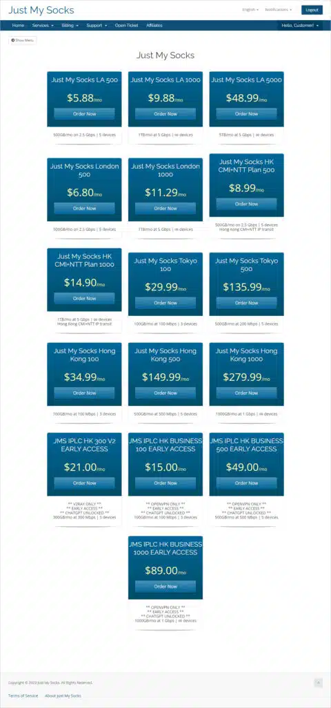
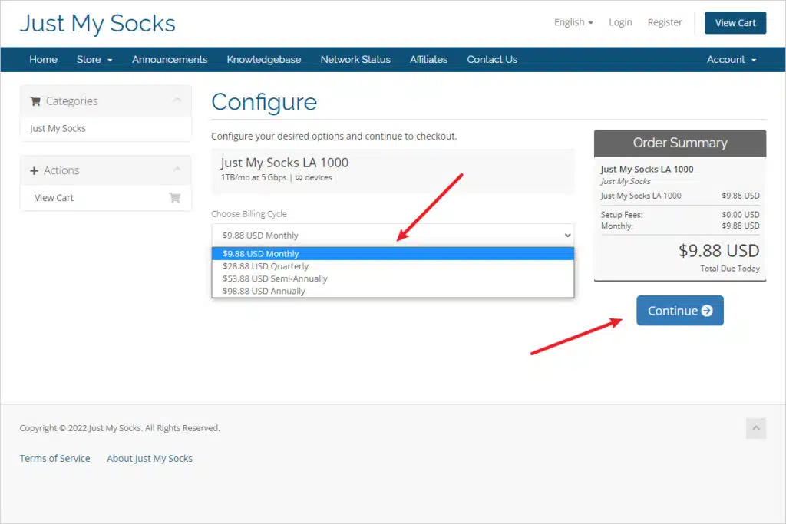
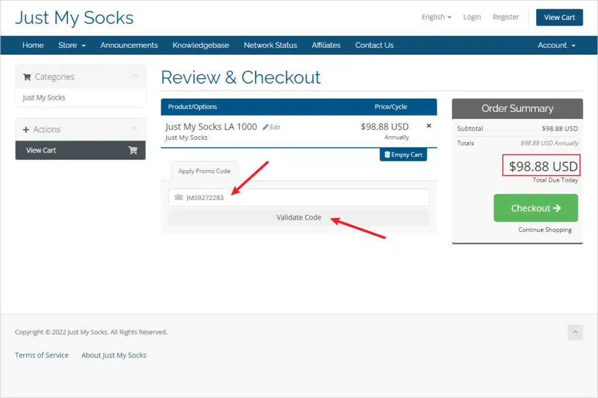
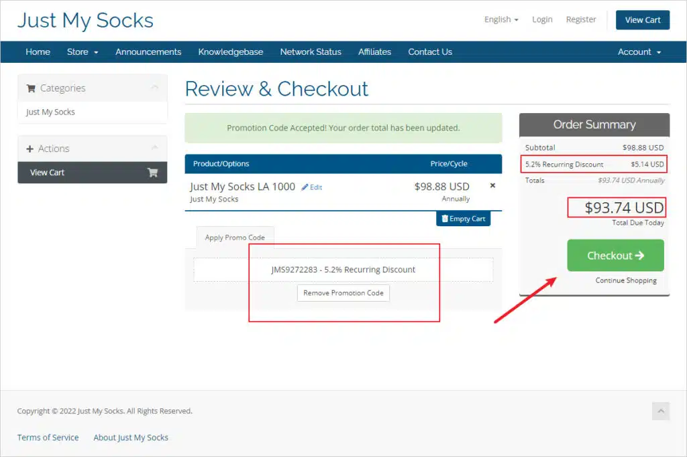
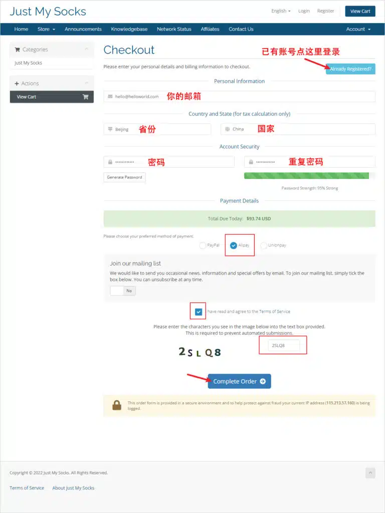
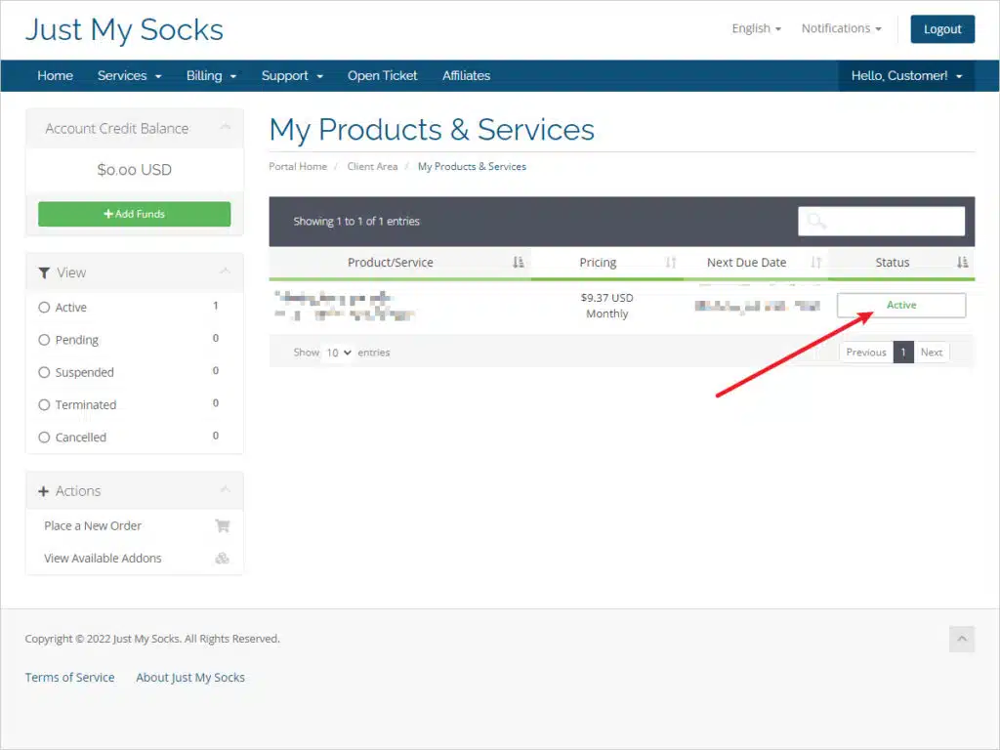
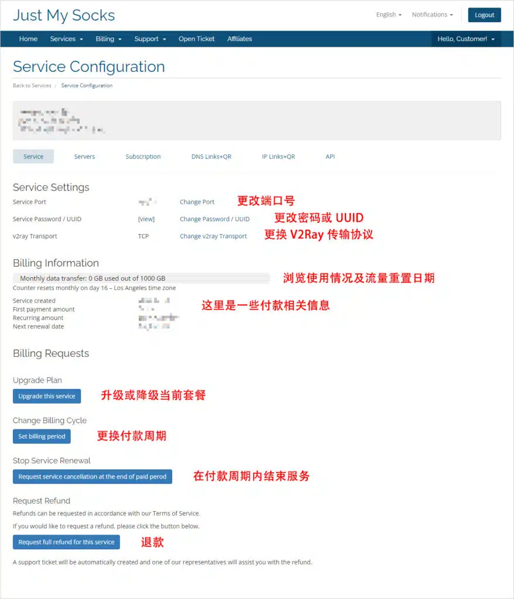
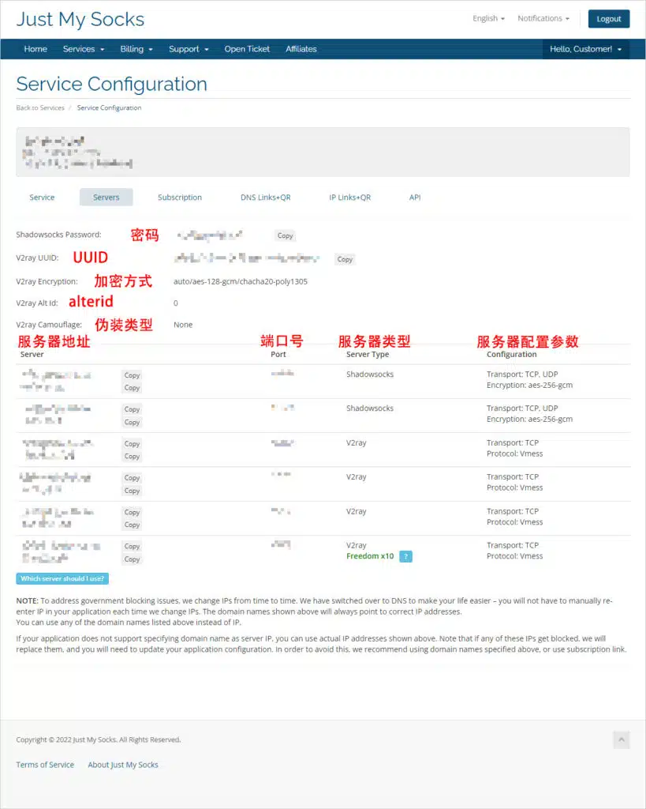
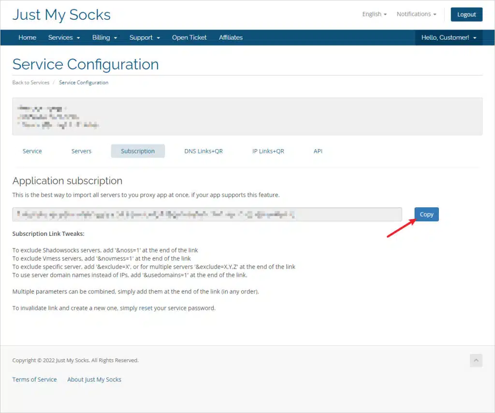
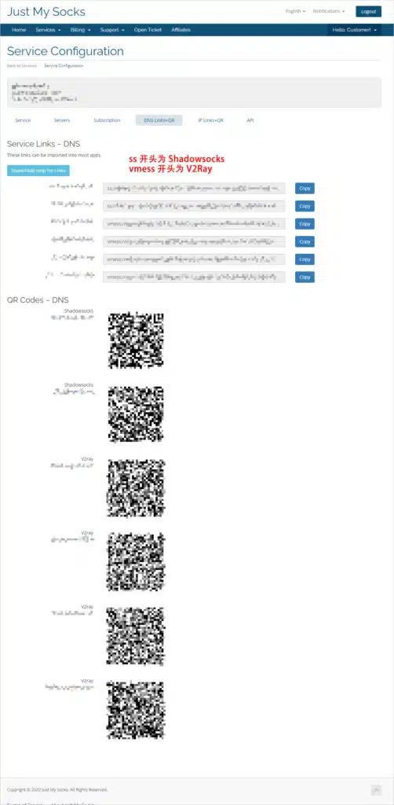

🇨🇳 [中文](README.md) | 🇺🇸 English | 🇷🇺 [Русский](README_RU.md) | 🇮🇷 [فارسی](README_FA.md)

# Just My Socks VPN by BandwagonHost: 2026 Registration and Purchase Guide with Discounts

Just My Socks is an official VPN service operated by BandwagonHost, a well-known VPS provider specializing in high-speed network connections.

The service accepts payments through Alipay, PayPal, and UnionPay cards. Customers can request a refund within 7 days if they are dissatisfied with the service. This refund policy also reflects the provider's confidence in its products.

Just My Socks uses high-speed CN2 and CN2 GIA network routes. One of its notable features is automatic server IP switching when an IP address becomes blocked, helping maintain connection speed and stability.

Just My Socks has long been a popular choice among users seeking reliable VPN connections.

If you are planning to purchase a subscription, this guide provides detailed instructions for registering an account, choosing a plan, and applying available discounts.

[BandwagonHost Just My Socks VPN Discount and Purchase Guide](https://github.com/jdnei/Just-My-Socks)

---

## Official Website

The official website of Just My Socks VPN by BandwagonHost is:

[https://justmysocks.net/](https://to.iix.im/jms) (Not accessible from mainland China)

### Alternative Official Websites

For various reasons, the primary website may occasionally become inaccessible.

To address this issue, the provider has established several official mirror websites, allowing users to access Just My Socks, register accounts, and purchase subscriptions.

All official mirror websites share the same account and service data.

If the main website is inaccessible, try one of the following alternatives:

* Official Mirror 1: [https://justmysocks1.net/](https://to.iix.im/jms) (Not accessible from mainland China)
* Official Mirror 2: [https://justmysocks2.net/](https://to.iix.im/jms) (Accessible from mainland China)
* Official Mirror 3: [https://justmysocks3.net/](https://to.iix.im/jms) (Accessible from mainland China)
* Official Mirror 4: [https://justmysocks5.net/](https://to.iix.im/jms) (Accessible from mainland China)

### Official Website Preview



### Advantages

Unlike many other VPN providers, Just My Socks is officially operated by BandwagonHost, offering users greater confidence in service stability and data security.

Its ten major advantages include:

1. Officially operated by BandwagonHost, providing a reliable service.
2. Excellent long-term availability and connection stability.
3. A 7-day refund policy with no questions asked.
4. Support for Alipay and UnionPay payments.
5. High-speed CN2 GIA network routes.
6. Automatic IP switching when an IP address becomes blocked.
7. Domain-based server configuration to avoid frequent manual changes.
8. Support for TCP and UDP protocols.
9. Customizable server passwords.
10. Customizable server ports.

Now that we have covered the main advantages of Just My Socks, let's proceed with the discounted purchase process.

---

## Choose a Server Location

Just My Socks currently offers five server location options: Los Angeles in the United States, London in the United Kingdom, Tokyo in Japan, Hong Kong in China, and an undisclosed location.

Each location offers multiple subscription plans.

### Plans & Pricing

| Data Center | Plan | Monthly Data | Monthly Price | Device Limit | Purchase Link |
| :--- | :--- | :--- | :--- | :--- | :--- |
| **Los Angeles** | LA 500 | 500 GB | $5.88 | 5 | [Discounted Purchase](https://to.iix.im/jms02) |
| **Los Angeles** | LA 1000 | 1 TB | $9.88 | Unlimited | [Discounted Purchase](https://to.iix.im/jms03) |
| **Los Angeles** | LA 5000 | 5 TB | $48.99 | Unlimited | [Discounted Purchase](https://to.iix.im/jms04) |
| **Los Angeles** | LA 10000 | 10 TB | $93.99 | Unlimited | [Discounted Purchase](https://to.iix.im/jms23) |
| **London** | London 500 | 500 GB | $6.80 | 5 | [Discounted Purchase](https://to.iix.im/jms12) |
| **London** | London 1000 | 1 TB | $11.29 | Unlimited | [Discounted Purchase](https://to.iix.im/jms14) |
| **Hong Kong** | HK CMI+NTT Plan 500 | 500 GB | $8.99 | 5 | [Discounted Purchase](https://to.iix.im/jms13) |
| **Hong Kong** | HK CMI+NTT Plan 1000 | 1 TB | $14.90 | Unlimited | [Discounted Purchase](https://to.iix.im/jms15) |
| **Hong Kong** | HK CMI+NTT Plan 5000 | 5 TB | $59.99 | Unlimited | [Discounted Purchase](https://to.iix.im/jms24) |
| **Tokyo** | Tokyo 100 | 100 GB | $29.99 | 3 | [Discounted Purchase](https://to.iix.im/jms05) |
| **Tokyo** | Tokyo 500 | 500 GB | $135.99 | 5 | [Discounted Purchase](https://to.iix.im/jms06) |
| **Tokyo** | Tokyo 1000 | 1 TB | $239.00 | Unlimited | [Discounted Purchase](https://to.iix.im/jms22) |
| **Tokyo** | Tokyo 5000 | 5 TB | $1135.00 | Unlimited | [Discounted Purchase](https://to.iix.im/jms26) |
| **Hong Kong** | Hong Kong 100 | 100 GB | $34.99 | 3 | [Discounted Purchase](https://to.iix.im/jms07) |
| **Hong Kong** | Hong Kong 500 | 500 GB | $149.99 | 5 | [Discounted Purchase](https://to.iix.im/jms08) |
| **Hong Kong** | Hong Kong 1000 | 1000 GB | $279.99 | Unlimited | [Discounted Purchase](https://to.iix.im/jms11) |
| **Hong Kong** | IPLC HK 300 V2 | 300 GB | $21.00 | 3 | Discontinued |
| **Hong Kong** | IPLC HK 1000 V2 | 1 TB | $59.00 | Unlimited | Discontinued |

### Plan Information

#### Recommended Plans

For the best value for money, the **LA 500** plan is highly recommended. It supports up to five devices simultaneously.

If you need to share the service among more users, consider the **LA 1000** plan, which has no device limit.

For users in mainland China who prioritize connection speed and low latency over price, Hong Kong and Tokyo are attractive choices because of their geographical proximity.

For business use, the **Hong Kong 500** and **Hong Kong 1000** plans are recommended for their speed and stability.

#### Monthly Data Allowance

First, a quick explanation of data units:

**1 GB = 1024 MB = 1024 × 1024 KB**

For streaming television shows:

* **Standard definition:** A 45-minute episode uses approximately 100 MB. With 1 GB, you can watch around 10 episodes.
* **540p video:** An episode uses approximately 200 MB. With 1 GB, you can watch around 5 episodes.
* **720p video:** An episode uses approximately 350 MB. With 1 GB, you can watch around 3 episodes.

If you mainly use Google for research, WhatsApp to communicate with customers, and Facebook for customer outreach, even a smaller plan such as Tokyo 100, Hong Kong 100, or IPLC HK 100, offering approximately 100 GB per month, should generally be sufficient.

#### Device Limits

In the plan listings:

* **∞ devices:** Unlimited devices.
* **5 devices:** Supports up to five devices simultaneously.

---

## Add a Plan to Your Shopping Cart

Choose your preferred server location and subscription plan from the table above.

Click the corresponding discounted purchase link, confirm the billing cycle, and add the plan to your shopping cart, as shown below.



### Select a Billing Cycle

Under the `Choose Billing Cycle` dropdown menu, select your preferred subscription duration.

For example:

`$xx.xx USD Annually`

This indicates annual billing.

Annual billing is recommended because the total cost is approximately equivalent to paying for 10 months instead of 12, saving around two months of subscription fees.

You can also apply a promotional code for additional savings.

After selecting the billing cycle, click `Continue` to add the plan to your shopping cart.

### Billing Cycle Comparison

| Billing Option | Payment Frequency | Discount Compared with Monthly Billing | Total Discount Including Promo Code |
| :--- | :--- | :--- | :--- |
| Monthly | Monthly payment | No discount | 5.2% |
| Quarterly | Payment every 3 months | 2.6% | 7.8% |
| Semi-Annually | Payment every 6 months | 9.1% | 14.3% |
| Annually | Annual payment — best value | 16.6% | 21.8% |

---

## Apply a Promo Code at Checkout

### Promo Code / Discount Code

`Use this code to receive a permanent 5.2% discount.`

```bash
JMS9272283
```

On the checkout page, locate the `Apply Promo Code` field and enter the Just My Socks promotional code:

`JMS9272283`

This code provides a permanent 5.2% discount.

After entering the code, click `Validate Code`.



### Checkout with the Discount Applied

The following screenshot shows an example of a successfully applied promotional code.

In this example, the displayed discount is **$5.14**, and the discounted total is **$93.74**.



If everything looks correct, click `Checkout` to continue.

---

## Complete Registration and Purchase

If you have not registered an account before, the checkout page will prompt you to create one.

Fill in the required information as shown in the screenshot below.

**Important:** Make sure your email address is correct and that you can receive account activation emails. Otherwise, you may be unable to activate and use your service after purchasing it.



In the example above, select `China` under `Country`.

For the payment method, you can choose `Alipay`.

The `Join our mailing list` option allows you to receive official emails, including promotional information.

The default setting is `NO`, meaning you will not receive these marketing emails.

Next, check the box labeled:

`I have read and agree to the Terms of Service`

Enter the verification code and click `Complete Order`.

You will then be redirected to the Alipay payment page, where you can scan the payment QR code and complete the transaction.

Once payment is complete, check your email for a message titled:

`Confirm Your Registration`

Click the activation link in that email to activate your account.

You have now completed the registration and purchase process.

---

## View Your Server Information

After completing the payment, you can sign in to your account dashboard to view your server configuration.

### Available Server List

Open the Just My Socks website and navigate to:

`Services` > `My Services`

Here, you can view your purchased services.

If the `Status` column displays `Active`, the corresponding service is currently available.



### Server Details

Click an `Active` service to view its server configuration details.



The page displays the relevant information for your purchased service.

#### Service Settings

This section allows you to:

* Change the server port.
* Change the server password.
* Modify the UUID.
* Switch the connection protocol.

#### Billing Information

This section displays your current data usage and billing information.

For example:

`Counter resets monthly on day 16 – Los Angeles time zone`

This means your monthly data allowance resets on the 16th day of each month.

The reset date depends on your payment date, and the time is calculated according to the Los Angeles time zone.

#### Billing Requests

This section provides several account management options.

| Option | Description |
| :--- | :--- |
| Upgrade Plan | Upgrade or downgrade the current subscription plan |
| Change Billing Cycle | Change the billing period, such as switching from monthly to annual payment |
| Stop Service Renewal | Automatically cancel the service at the end of the current paid period |
| Request Refund | Submit a refund request |

---

## Configure Your VPN Servers

Just My Socks supports five methods of configuring servers:

1. Manual server configuration.
2. Subscription URL configuration.
3. Configuration through a link or QR code.
4. Configuration through an IP address or QR code.
5. API-based configuration.

This guide focuses on the first three methods.

**The recommended method is configuration through a subscription URL.**

### Manual Server Configuration

Unless manual configuration is required, using a subscription URL, configuration link, or QR code is recommended.

These methods are faster, more convenient, and less likely to result in configuration errors.

In your account dashboard, open the `Servers` section to view the server configuration details.



#### Configure a Shadowsocks Server

Find a server entry where `Server Type` is `Shadowsocks`.

The corresponding row contains the Shadowsocks server configuration information.

The `Encryption` field specifies the encryption method. Make sure you select the correct encryption method when configuring your Shadowsocks client.

The password is shown in the `Shadowsocks Password` field.

To configure Shadowsocks, you generally need only four pieces of information:

1. Server address.
2. Encryption method.
3. Server port.
4. Password.

After entering these details into a compatible Shadowsocks client, you can establish the connection.

#### Configure a V2Ray Server

Find a server entry where `Server Type` is `V2Ray`.

The corresponding row contains the V2Ray server configuration information.

The `Protocol` field specifies the transport protocol, which must be selected correctly in your V2Ray client.

Other required settings can be found in the fields beginning with `V2Ray`:

* **User ID:** `V2Ray uuid`
* **Alter ID:** `V2Ray Alt Id` — set to `0` in this example.
* **Encryption:** `auto`
* **Transport Protocol:** `TCP`
* **Camouflage Type:** `V2Ray Camouflage` — set to `none` in this example.

#### Notes on Manual Configuration

* Shadowsocks and V2Ray use the same server port.
* The configuration details are generally identical across servers, except for the server address.
* Using a domain name instead of an IP address is recommended.

As mentioned earlier, Just My Socks can automatically switch IP addresses when the current IP becomes blocked.

Using a domain name for your server configuration helps avoid having to update the IP address manually every time it changes.

### Configure Servers Using a Subscription URL

Just My Socks supports automatic server configuration through subscription URLs.

By copying the subscription link into a compatible client, you can import the server configuration without entering each setting manually.

In your account dashboard, locate the `Subscription` section.

Under `Application subscription`, you will find your subscription URL.



Click `Copy` to copy your Just My Socks subscription URL.

Then paste the URL into a compatible VPN or proxy client that supports subscription imports.

After adding the subscription, remember to update or refresh it in the client to load the server configuration.

#### Advanced Subscription URL Configuration

You can customize your subscription URL using the following parameters:

* **Import only V2Ray servers:** Append `&noss=1` to the end of the subscription URL.
* **Import only Shadowsocks servers:** Append `&novmess=1` to the end of the subscription URL.
* **Exclude specific servers:** Append `&exclude=X` to exclude one server, or `&exclude=X,Y,Z` to exclude multiple servers.
* **Use domain names as server addresses:** Append `&usedomains=1` to the end of the subscription URL.

These advanced parameters can be combined in any order.

### Configure Servers Using Links or QR Codes

After purchasing a subscription, Just My Socks automatically generates configuration links and QR codes for the available servers.

If your VPN client supports QR code scanning, you can import the configuration directly.

In your account dashboard, locate the `DNS Link` + `QR` option.

This method uses domain names as server addresses and is recommended.

Click the option to view the configuration links and QR codes.



#### Just My Socks Server Configuration Links

Click `Copy` to copy the server configuration link.

You can then import the link into a compatible client application.

The link prefixes identify the protocol:

* `ss://` — Shadowsocks server link.
* `vmess://` — V2Ray server link.

#### Just My Socks Server QR Codes

Use a compatible client application with a QR code scanner to scan the corresponding QR code.

The server configuration will then be imported automatically.

#### Special Note

The instructions also mention a configuration option using IP addresses as server addresses.

Using IP addresses directly is not recommended because domain-based configuration makes automatic IP switching more convenient.

---

## Supported Client Applications

Just My Socks supports both Shadowsocks and V2Ray protocols.

Therefore, you can use any compatible client application supporting these protocols.

Recommended applications include:

* **Windows:** v2rayN / Clash for Windows
* **macOS:** V2rayU / ClashX
* **iOS:** Shadowrocket / Quantumult / Quantumult X
* **Android:** v2rayNG / Clash for Android

---

## Speed and Network Route Analysis

### Hong Kong Servers

A Hong Kong subscription provides access to five servers, all using the same network routing configuration.

* **Inbound Routes**
  * China Telecom: CN2 GIA.
  * China Unicom: Direct connection.
  * China Mobile: Direct connection.
* **Outbound Routes**
  * China Telecom: CN2 GIA.
  * China Unicom: Direct connection.
  * China Mobile: Direct connection.

### Tokyo Servers

A Tokyo subscription provides access to five servers, all using the same network routing configuration.

* **Outbound Routes**
  * China Telecom: CN2 GIA.
  * China Unicom: CN2 GIA.
  * China Mobile: CN2 GIA.
* **Inbound Routes**
  * China Telecom: CN2 GIA.
  * China Unicom: CN2 GIA.
  * China Mobile: NTT.

### London Servers

A London subscription provides access to five servers, all using the same network routing configuration.

* **Outbound Routes**
  * China Telecom: China Unicom premium international route.
  * China Unicom: China Unicom premium international route.
  * China Mobile: China Unicom premium international route.
* **Inbound Routes**
  * China Telecom: China Unicom premium international route.
  * China Unicom: China Unicom premium international route.
  * China Mobile: Level3.

### Los Angeles Servers

A Los Angeles subscription provides access to six servers, with slightly different routing configurations.

* Server `cXs1` uses CN2 GT and direct connections to China Unicom and China Mobile.
* Server `cXs2` uses CN2 GT and direct connections to China Unicom and China Mobile.
* Server `cXs3` uses China Telecom's CN2 GIA direct route.
* Server `cXs4` uses BandwagonHost's Osaka, Japan POP connection.
* Server `cXs5` uses BandwagonHost's Netherlands POP route combined with CN2 GIA and direct return routes to China Telecom, China Unicom, and China Mobile.

In these server names, the character `X` varies depending on the purchased plan.

The suffixes `s1` through `s5` identify the corresponding servers.

Los Angeles plans also include a V2Ray route named `s801`.

This route may provide greater data transfer capacity, but its speed and stability are not guaranteed.

It is better suited for downloading large files when consistent performance is less important.

---

## Frequently Asked Questions

### Which Payment Methods Are Supported?

Just My Socks currently supports:

* PayPal.
* Alipay.
* China UnionPay cards.

### Is a Refund Available?

Yes. Just My Socks offers a 7-day refund policy.

You can request a refund within 7 days of purchasing the service.

### Is UDP Supported?

* V2Ray servers in all regions do not support UDP.
* Shadowsocks servers in all regions support UDP, except for the discontinued LA 100 plan.

### Does Just My Socks Support ChatGPT?

According to the provider, the service now supports access to ChatGPT.
