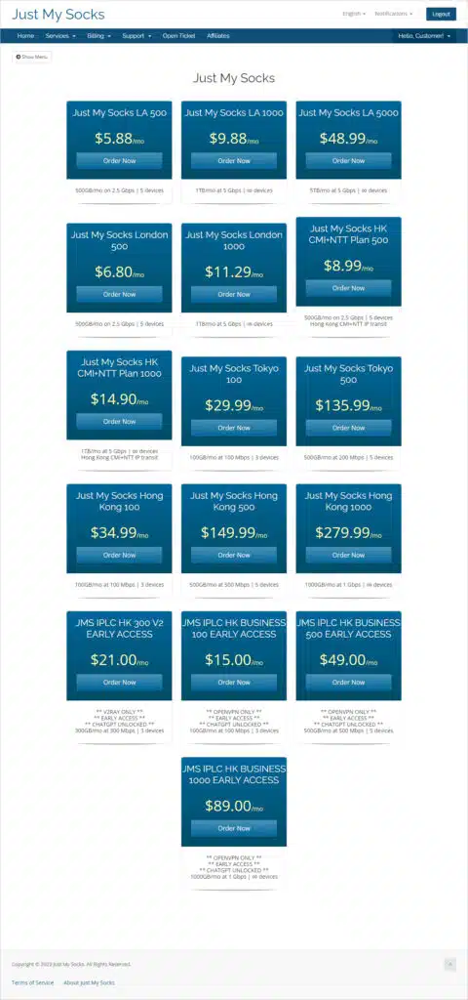
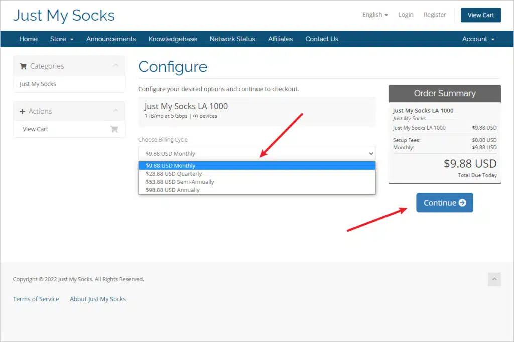
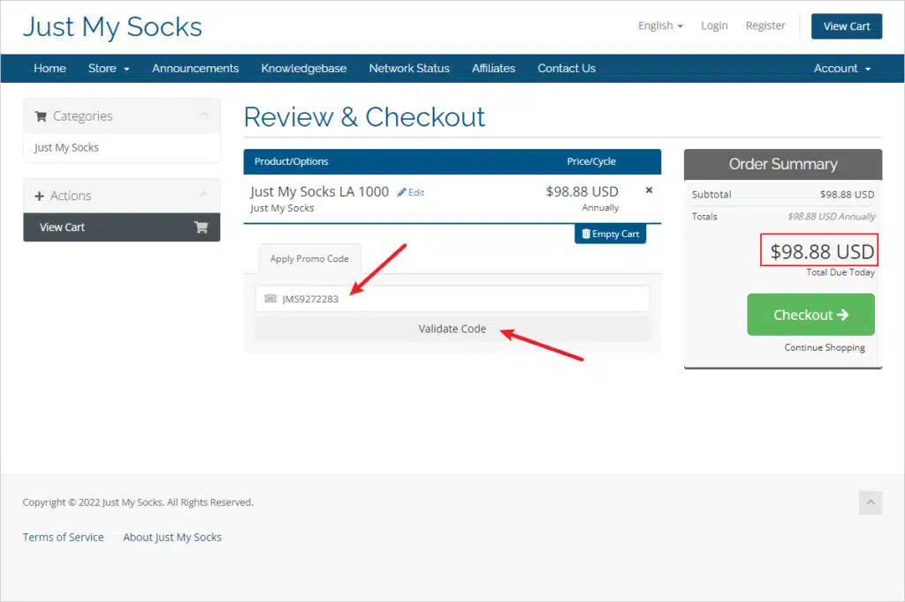
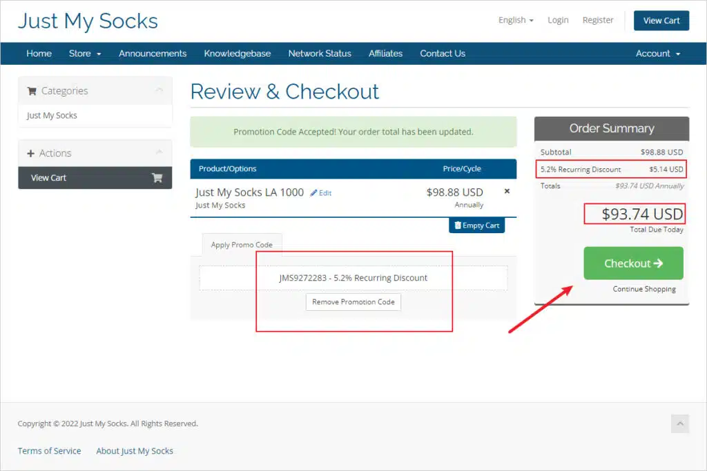
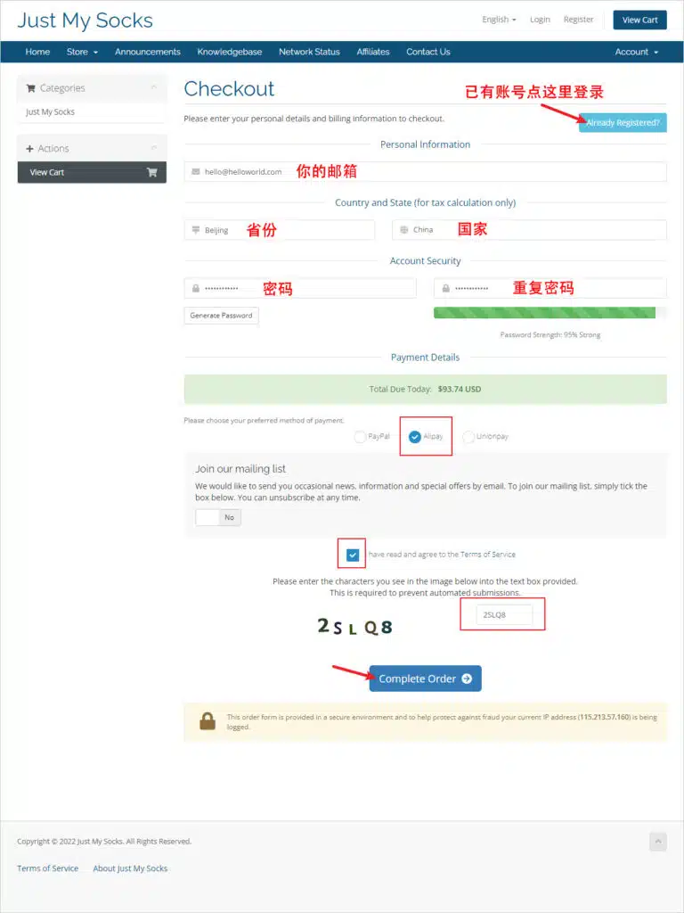
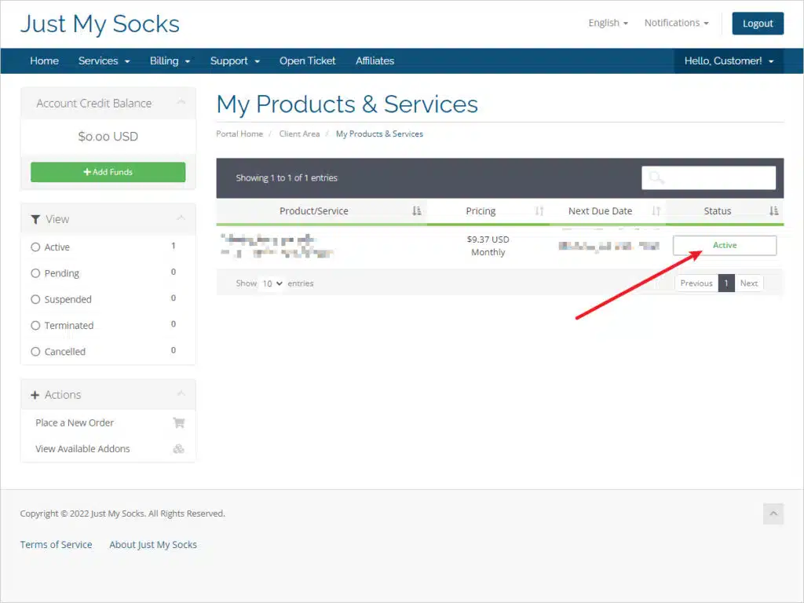
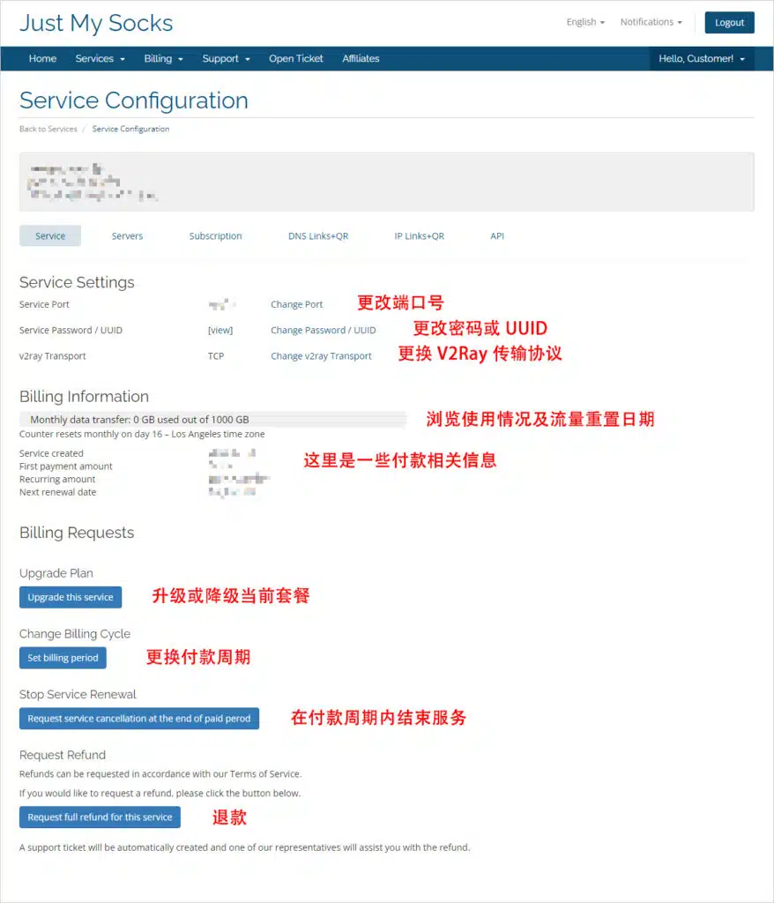
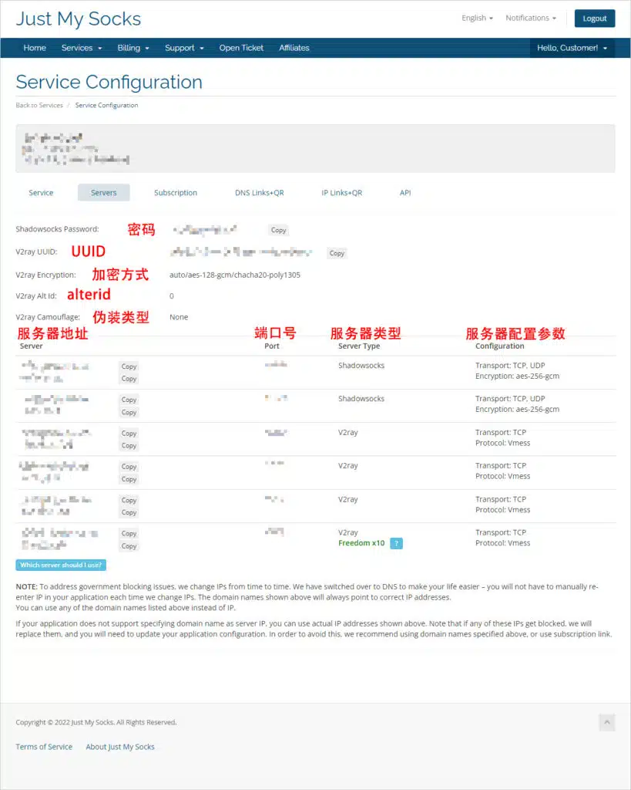
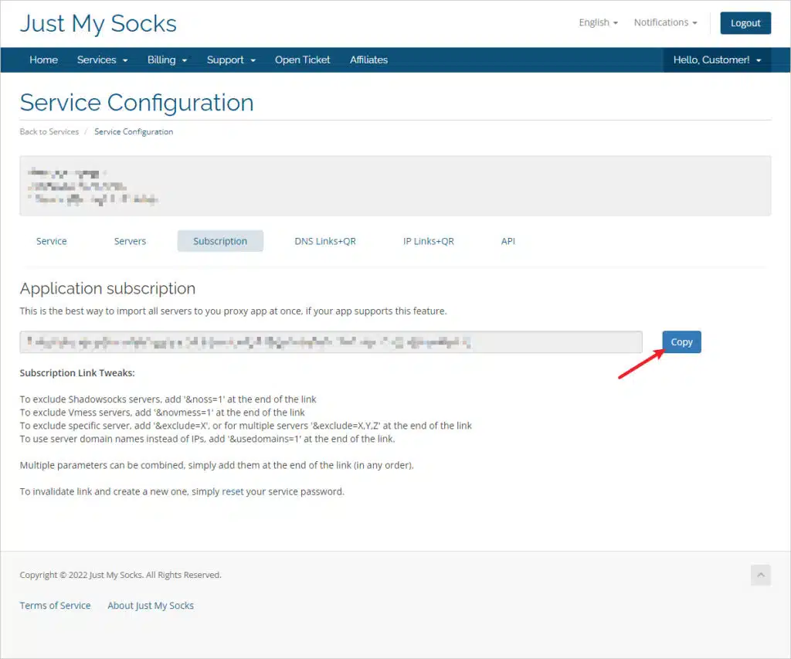
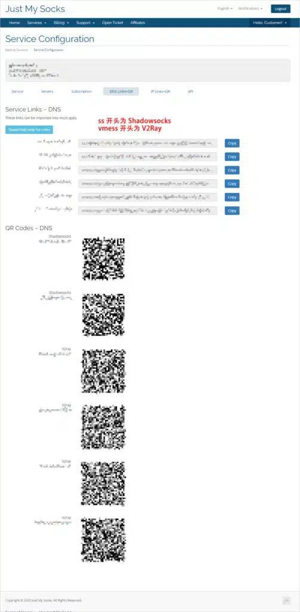

 🇨🇳 [中文](README.md) | 🇺🇸 [English](README_EN.md) | 🇷🇺 [Русский](README_RU.md) | 🇮🇷 فارسی

# آموزش ثبت‌نام و خرید VPN جاست مای ساکس (Just My Socks) از BandwagonHost در سال ۲۰۲۶ همراه با تخفیف

Just My Socks یک سرویس VPN رسمی است که توسط BandwagonHost، ارائه‌دهنده شناخته‌شده سرورهای مجازی VPS با خطوط ارتباطی پرسرعت، اداره می‌شود.

این سرویس از پرداخت از طریق Alipay، PayPal و کارت‌های UnionPay پشتیبانی می‌کند. اگر طی ۷ روز پس از خرید از خدمات رضایت نداشته باشید، می‌توانید درخواست بازپرداخت وجه بدهید. این سیاست بازپرداخت نشان‌دهنده اطمینان ارائه‌دهنده به کیفیت محصولات خود نیز هست.

Just My Socks از خطوط پرسرعت CN2 و CN2 GIA استفاده می‌کند. یکی از ویژگی‌های مهم آن، تغییر خودکار IP سرور هنگام مسدودشدن آدرس IP فعلی است که به حفظ سرعت و پایداری اتصال کمک می‌کند.

این سرویس مدت‌هاست یکی از گزینه‌های محبوب کاربران برای دسترسی به اینترنت بین‌المللی محسوب می‌شود.

اگر قصد خرید اشتراک دارید، این راهنما تمام مراحل ثبت‌نام، انتخاب سرویس و خرید با تخفیف را به‌صورت گام‌به‌گام توضیح می‌دهد.

[آموزش خرید VPN جاست مای ساکس با تخفیف](https://github.com/jdnei/Just-My-Socks)

---

## وب‌سایت رسمی

آدرس رسمی VPN جاست مای ساکس متعلق به BandwagonHost:

[https://justmysocks.net/](https://to.iix.im/jms) (از داخل سرزمین اصلی چین قابل دسترسی نیست)

### آدرس‌های جایگزین رسمی

گاهی به دلایل مختلف، وب‌سایت اصلی ممکن است در دسترس نباشد.

به همین دلیل، ارائه‌دهنده چندین وب‌سایت آینه‌ای رسمی ایجاد کرده است تا کاربران بتوانند از طریق آن‌ها به Just My Socks دسترسی پیدا کنند، حساب بسازند و اشتراک خریداری کنند.

اطلاعات حساب‌ها و سرویس‌ها میان تمام این آدرس‌های رسمی مشترک است.

اگر وب‌سایت اصلی باز نمی‌شود، می‌توانید از آدرس‌های زیر استفاده کنید:

* آدرس جایگزین رسمی ۱: [https://justmysocks1.net/](https://to.iix.im/jms) (از سرزمین اصلی چین قابل دسترسی نیست)
* آدرس جایگزین رسمی ۲: [https://justmysocks2.net/](https://to.iix.im/jms) (از سرزمین اصلی چین قابل دسترسی است)
* آدرس جایگزین رسمی ۳: [https://justmysocks3.net/](https://to.iix.im/jms) (از سرزمین اصلی چین قابل دسترسی است)
* آدرس جایگزین رسمی ۴: [https://justmysocks5.net/](https://to.iix.im/jms) (از سرزمین اصلی چین قابل دسترسی است)

### پیش‌نمایش وب‌سایت رسمی



### مزایا

برخلاف بسیاری از سرویس‌های VPN دیگر، Just My Socks مستقیماً توسط BandwagonHost اداره می‌شود و این موضوع می‌تواند اطمینان بیشتری نسبت به پایداری خدمات و امنیت داده‌ها ایجاد کند.

ده مزیت اصلی این سرویس عبارت‌اند از:

1. سرویس رسمی BandwagonHost با اعتبار و قابلیت اعتماد بالا.
2. پایداری عالی و امکان استفاده بلندمدت.
3. امکان درخواست بازپرداخت وجه بدون نیاز به ارائه دلیل تا ۷ روز.
4. پشتیبانی از پرداخت با Alipay و کارت‌های UnionPay.
5. استفاده از خطوط پرسرعت CN2 GIA.
6. تغییر خودکار IP هنگام مسدودشدن آدرس فعلی.
7. پشتیبانی از اتصال از طریق نام دامنه برای جلوگیری از تنظیمات مکرر.
8. پشتیبانی از پروتکل‌های TCP و UDP.
9. امکان تعیین رمز عبور دلخواه برای سرور.
10. امکان تغییر و تنظیم پورت سرور.

پس از آشنایی با مزایای Just My Socks، به مراحل خرید با تخفیف می‌پردازیم.

---

## انتخاب موقعیت سرور

Just My Socks در حال حاضر پنج گزینه موقعیت سرور ارائه می‌دهد: لس‌آنجلس در آمریکا، لندن در بریتانیا، توکیو در ژاپن، هنگ‌کنگ در چین و یک موقعیت اعلام‌نشده.

هر موقعیت دارای چندین طرح اشتراک است.

### فهرست طرح‌ها و قیمت‌ها

| مرکز داده | نام طرح | ترافیک ماهانه | قیمت ماهانه | محدودیت دستگاه | لینک خرید |
| :--- | :--- | :--- | :--- | :--- | :--- |
| **لس‌آنجلس** | LA 500 | 500 GB | $5.88 | ۵ | [خرید با تخفیف](https://to.iix.im/jms02) |
| **لس‌آنجلس** | LA 1000 | 1 TB | $9.88 | نامحدود | [خرید با تخفیف](https://to.iix.im/jms03) |
| **لس‌آنجلس** | LA 5000 | 5 TB | $48.99 | نامحدود | [خرید با تخفیف](https://to.iix.im/jms04) |
| **لس‌آنجلس** | LA 10000 | 10 TB | $93.99 | نامحدود | [خرید با تخفیف](https://to.iix.im/jms23) |
| **لندن** | London 500 | 500 GB | $6.80 | ۵ | [خرید با تخفیف](https://to.iix.im/jms12) |
| **لندن** | London 1000 | 1 TB | $11.29 | نامحدود | [خرید با تخفیف](https://to.iix.im/jms14) |
| **هنگ‌کنگ** | HK CMI+NTT Plan 500 | 500 GB | $8.99 | ۵ | [خرید با تخفیف](https://to.iix.im/jms13) |
| **هنگ‌کنگ** | HK CMI+NTT Plan 1000 | 1 TB | $14.90 | نامحدود | [خرید با تخفیف](https://to.iix.im/jms15) |
| **هنگ‌کنگ** | HK CMI+NTT Plan 5000 | 5 TB | $59.99 | نامحدود | [خرید با تخفیف](https://to.iix.im/jms24) |
| **توکیو** | Tokyo 100 | 100 GB | $29.99 | ۳ | [خرید با تخفیف](https://to.iix.im/jms05) |
| **توکیو** | Tokyo 500 | 500 GB | $135.99 | ۵ | [خرید با تخفیف](https://to.iix.im/jms06) |
| **توکیو** | Tokyo 1000 | 1 TB | $239.00 | نامحدود | [خرید با تخفیف](https://to.iix.im/jms22) |
| **توکیو** | Tokyo 5000 | 5 TB | $1135.00 | نامحدود | [خرید با تخفیف](https://to.iix.im/jms26) |
| **هنگ‌کنگ** | Hong Kong 100 | 100 GB | $34.99 | ۳ | [خرید با تخفیف](https://to.iix.im/jms07) |
| **هنگ‌کنگ** | Hong Kong 500 | 500 GB | $149.99 | ۵ | [خرید با تخفیف](https://to.iix.im/jms08) |
| **هنگ‌کنگ** | Hong Kong 1000 | 1000 GB | $279.99 | نامحدود | [خرید با تخفیف](https://to.iix.im/jms11) |
| **هنگ‌کنگ** | IPLC HK 300 V2 | 300 GB | $21.00 | ۳ | از فروش خارج شده |
| **هنگ‌کنگ** | IPLC HK 1000 V2 | 1 TB | $59.00 | نامحدود | از فروش خارج شده |

### توضیحات طرح‌ها

#### طرح‌های پیشنهادی

اگر به دنبال بهترین نسبت قیمت به امکانات هستید، طرح **LA 500** پیشنهاد می‌شود. این طرح امکان استفاده هم‌زمان از پنج دستگاه را فراهم می‌کند.

اگر قرار است افراد بیشتری از سرویس استفاده کنند، طرح **LA 1000** گزینه مناسب‌تری است؛ زیرا محدودیتی برای تعداد دستگاه‌ها ندارد.

برای کاربران سرزمین اصلی چین که سرعت بالا و تأخیر کم برایشان اهمیت بیشتری نسبت به قیمت دارد، مسیرهای هنگ‌کنگ و توکیو به دلیل نزدیکی جغرافیایی گزینه‌های مناسبی هستند.

برای استفاده تجاری و شرکتی نیز طرح‌های **Hong Kong 500** و **Hong Kong 1000** به دلیل سرعت و پایداری توصیه می‌شوند.

#### حجم ترافیک ماهانه

ابتدا توضیح کوتاهی درباره واحدهای حجم داده:

**1 GB = 1024 MB = 1024 × 1024 KB**

برای تماشای سریال:

* **کیفیت استاندارد:** یک قسمت ۴۵ دقیقه‌ای تقریباً 100 MB حجم دارد. با 1 GB می‌توان حدود ۱۰ قسمت تماشا کرد.
* **کیفیت 540p:** هر قسمت تقریباً 200 MB حجم دارد. با 1 GB می‌توان حدود ۵ قسمت تماشا کرد.
* **کیفیت 720p:** هر قسمت تقریباً 350 MB حجم دارد. با 1 GB می‌توان حدود ۳ قسمت تماشا کرد.

اگر استفاده روزمره شما بیشتر شامل جست‌وجو در Google، ارتباط با مشتریان از طریق WhatsApp و جذب مشتری از طریق Facebook است، حتی طرح‌های کم‌حجم‌تر مانند Tokyo 100، Hong Kong 100 یا IPLC HK 100 با حدود 100 GB ترافیک ماهانه نیز معمولاً کافی خواهند بود.

#### محدودیت تعداد دستگاه

در فهرست طرح‌ها:

* **∞ devices:** تعداد دستگاه نامحدود.
* **5 devices:** حداکثر پنج دستگاه به‌صورت هم‌زمان.

---

## افزودن طرح به سبد خرید

از جدول بالا، موقعیت سرور و طرح موردنظر خود را انتخاب کنید.

روی لینک خرید با تخفیف کلیک کنید، دوره پرداخت را بررسی کرده و سرویس را به سبد خرید اضافه کنید.



### انتخاب دوره پرداخت

در منوی کشویی `Choose Billing Cycle`، مدت اشتراک موردنظر را انتخاب کنید.

برای مثال:

`$xx.xx USD Annually`

این گزینه به معنای پرداخت سالانه است.

پرداخت سالانه پیشنهاد می‌شود؛ زیرا هزینه مجموع آن تقریباً معادل ۱۰ ماه پرداخت ماهانه است و در نتیجه حدود دو ماه هزینه اشتراک صرفه‌جویی می‌شود.

همچنین می‌توانید برای کاهش بیشتر هزینه از کد تخفیف استفاده کنید.

پس از انتخاب دوره پرداخت، روی `Continue` کلیک کنید تا طرح به سبد خرید افزوده شود.

### مقایسه دوره‌های پرداخت

| گزینه پرداخت | دوره پرداخت | تخفیف نسبت به پرداخت ماهانه | مجموع تخفیف با کد تخفیف |
| :--- | :--- | :--- | :--- |
| Monthly | ماهانه | بدون تخفیف | 5.2% |
| Quarterly | هر سه ماه | 2.6% | 7.8% |
| Semi-Annually | هر شش ماه | 9.1% | 14.3% |
| Annually | سالانه؛ مقرون‌به‌صرفه‌ترین گزینه | 16.6% | 21.8% |

---

## استفاده از کد تخفیف هنگام پرداخت

### کد تخفیف

`با استفاده از این کد، از تخفیف دائمی ۵٫۲٪ بهره‌مند شوید.`

```bash
JMS9272283
```

در صفحه پرداخت، قسمت `Apply Promo Code` را پیدا کرده و کد تخفیف Just My Socks را وارد کنید:

`JMS9272283`

این کد تخفیف دائمی ۵٫۲٪ ارائه می‌دهد.

پس از واردکردن کد، روی `Validate Code` کلیک کنید.



### محاسبه مبلغ پس از تخفیف

تصویر زیر نمونه‌ای از اعمال موفق کد تخفیف را نشان می‌دهد.

در این مثال، مبلغ تخفیف **$5.14** و مبلغ نهایی پس از تخفیف **$93.74** است.



اگر اطلاعات سفارش صحیح است، روی `Checkout` کلیک کنید.

---

## تکمیل ثبت‌نام و خرید

اگر قبلاً حساب کاربری ایجاد نکرده‌اید، صفحه پرداخت از شما می‌خواهد که ثبت‌نام کنید.

اطلاعات موردنیاز را مطابق تصویر زیر وارد کنید.

**نکته مهم:** حتماً آدرس ایمیل صحیح وارد کنید و مطمئن شوید که می‌توانید ایمیل فعال‌سازی حساب را دریافت کنید؛ در غیر این صورت، ممکن است پس از خرید امکان فعال‌سازی و استفاده از سرویس وجود نداشته باشد.



در مثال تصویر بالا، در قسمت `Country` گزینه `China` را انتخاب کنید.

برای روش پرداخت می‌توانید `Alipay` را انتخاب کنید.

گزینه `Join our mailing list` مربوط به عضویت در فهرست ایمیل‌های رسمی و دریافت اطلاعیه‌ها و پیشنهادهای تخفیفی است.

مقدار پیش‌فرض این گزینه `NO` است؛ یعنی ایمیل‌های تبلیغاتی دریافت نخواهید کرد.

سپس گزینه زیر را علامت بزنید:

`I have read and agree to the Terms of Service`

کد تأیید را وارد کنید و روی `Complete Order` کلیک کنید.

پس از آن، به صفحه پرداخت Alipay منتقل می‌شوید. با اسکن کد QR پرداخت می‌توانید تراکنش را تکمیل کنید.

پس از پرداخت، ایمیل خود را بررسی کنید و به دنبال پیامی با عنوان زیر باشید:

`Confirm Your Registration`

روی لینک داخل ایمیل کلیک کنید تا حساب شما فعال شود.

اکنون مراحل ثبت‌نام و خرید با موفقیت تکمیل شده است.

---

## مشاهده اطلاعات سرورها

پس از تکمیل خرید و پرداخت، می‌توانید وارد پنل کاربری شوید و اطلاعات پیکربندی سرورها را مشاهده کنید.

### فهرست سرورهای قابل استفاده

وب‌سایت Just My Socks را باز کنید و از منو به مسیر زیر بروید:

`Services` > `My Services`

در این بخش، اطلاعات سرویس‌های خریداری‌شده نمایش داده می‌شود.

اگر در ستون `Status` عبارت `Active` نوشته شده باشد، سرویس مربوطه فعال و قابل استفاده است.



### اطلاعات سرور

روی سرویسی که وضعیت آن `Active` است کلیک کنید تا جزئیات پیکربندی سرور نمایش داده شود.



در این صفحه تمام اطلاعات مهم سرویس خریداری‌شده قابل مشاهده است.

#### Service Settings

در این بخش می‌توانید:

* پورت سرور را تغییر دهید.
* رمز عبور سرور را تغییر دهید.
* مقدار UUID را ویرایش کنید.
* پروتکل اتصال را تغییر دهید.

#### Billing Information

این بخش میزان مصرف ترافیک و اطلاعات پرداخت اشتراک را نمایش می‌دهد.

برای مثال:

`Counter resets monthly on day 16 – Los Angeles time zone`

این عبارت به معنای بازنشانی حجم اینترنت در روز شانزدهم هر ماه است.

تاریخ بازنشانی بر اساس زمان پرداخت تعیین می‌شود و محاسبه زمان بر مبنای منطقه زمانی لس‌آنجلس انجام می‌گیرد.

#### Billing Requests

در این بخش می‌توانید درخواست‌های مختلف مربوط به اشتراک را ثبت کنید.

| گزینه | توضیحات |
| :--- | :--- |
| Upgrade Plan | ارتقا یا کاهش سطح طرح فعلی |
| Change Billing Cycle | تغییر دوره پرداخت، مانند تبدیل اشتراک ماهانه به سالانه |
| Stop Service Renewal | لغو خودکار سرویس پس از پایان دوره پرداخت‌شده |
| Request Refund | ثبت درخواست بازپرداخت وجه |

---

## پیکربندی سرورهای VPN

Just My Socks از پنج روش برای پیکربندی سرورها پشتیبانی می‌کند:

1. پیکربندی دستی سرور.
2. پیکربندی با استفاده از لینک اشتراک.
3. پیکربندی با لینک یا کد QR.
4. پیکربندی با آدرس IP یا کد QR.
5. پیکربندی از طریق API.

در این راهنما، سه روش اول توضیح داده می‌شوند.

**روش پیشنهادی، استفاده از لینک اشتراک است.**

### پیکربندی دستی سرور

اگر استفاده از تنظیمات دستی ضروری نیست، بهتر است از لینک اشتراک، لینک پیکربندی یا کد QR استفاده کنید.

این روش‌ها سریع‌تر و آسان‌تر هستند و احتمال اشتباه در واردکردن تنظیمات را کاهش می‌دهند.

در پنل کاربری، بخش `Servers` را باز کنید تا جزئیات پیکربندی سرورها را مشاهده کنید.



#### پیکربندی سرور Shadowsocks

ردیفی را پیدا کنید که مقدار `Server Type` در آن `Shadowsocks` باشد.

این ردیف شامل اطلاعات پیکربندی سرور Shadowsocks است.

قسمت `Encryption` روش رمزگذاری را مشخص می‌کند. هنگام تنظیم کلاینت Shadowsocks، حتماً روش رمزگذاری صحیح را انتخاب کنید.

رمز عبور نیز در قسمت `Shadowsocks Password` نمایش داده می‌شود.

برای پیکربندی Shadowsocks معمولاً فقط چهار مورد لازم است:

1. آدرس سرور.
2. روش رمزگذاری.
3. پورت سرور.
4. رمز عبور.

پس از واردکردن این اطلاعات در کلاینت سازگار، می‌توانید اتصال را برقرار کنید.

#### پیکربندی سرور V2Ray

ردیفی را پیدا کنید که مقدار `Server Type` در آن `V2Ray` باشد.

این ردیف شامل اطلاعات پیکربندی سرور V2Ray است.

قسمت `Protocol` پروتکل انتقال داده را مشخص می‌کند و باید هنگام پیکربندی کلاینت V2Ray به‌درستی انتخاب شود.

سایر تنظیمات موردنیاز در قسمت‌هایی که با `V2Ray` شروع می‌شوند قرار دارند:

* **شناسه کاربر:** `V2Ray uuid`
* **شناسه اضافی:** `V2Ray Alt Id` — در این مثال مقدار `0`.
* **رمزگذاری:** `auto`
* **پروتکل انتقال:** `TCP`
* **نوع استتار:** `V2Ray Camouflage` — در این مثال مقدار `none`.

#### نکات پیکربندی دستی

* پورت سرور برای Shadowsocks و V2Ray یکسان است.
* تنظیمات سرورها معمولاً مشابه هستند و فقط آدرس سرور تفاوت دارد.
* استفاده از نام دامنه به‌جای آدرس IP توصیه می‌شود.

همان‌طور که پیش‌تر گفته شد، Just My Socks می‌تواند هنگام مسدودشدن IP فعلی، آدرس IP را به‌صورت خودکار تغییر دهد.

اگر در تنظیمات از نام دامنه استفاده کنید، دیگر لازم نیست پس از هر تغییر IP، آدرس سرور را به‌صورت دستی اصلاح کنید.

### پیکربندی با استفاده از لینک اشتراک

Just My Socks امکان پیکربندی خودکار سرورها از طریق لینک اشتراک را فراهم می‌کند.

با کپی‌کردن لینک اشتراک در یک کلاینت سازگار، می‌توانید اطلاعات سرورها را بدون واردکردن دستی تنظیمات دریافت کنید.

در پنل کاربری، بخش `Subscription` را پیدا کنید.

در قسمت `Application subscription`، لینک اشتراک شما نمایش داده می‌شود.



روی `Copy` کلیک کنید تا لینک اشتراک Just My Socks کپی شود.

سپس این لینک را در کلاینت VPN یا پروکسی سازگار با قابلیت واردکردن اشتراک قرار دهید.

پس از افزودن لینک، گزینه به‌روزرسانی اشتراک را در کلاینت اجرا کنید تا اطلاعات سرورها دریافت شود.

#### تنظیمات پیشرفته لینک اشتراک

می‌توانید پارامترهای زیر را به انتهای لینک اشتراک اضافه کنید:

* **فقط واردکردن سرورهای V2Ray:** عبارت `&noss=1` را به انتهای لینک اضافه کنید.
* **فقط واردکردن سرورهای Shadowsocks:** عبارت `&novmess=1` را به انتهای لینک اضافه کنید.
* **حذف سرورهای مشخص:** برای حذف یک سرور از `&exclude=X` و برای حذف چند سرور از `&exclude=X,Y,Z` استفاده کنید.
* **استفاده از نام دامنه به‌عنوان آدرس سرور:** عبارت `&usedomains=1` را به انتهای لینک اضافه کنید.

این پارامترهای پیشرفته را می‌توان با هر ترتیبی با یکدیگر ترکیب کرد.

### پیکربندی با لینک یا کد QR

پس از خرید اشتراک، Just My Socks به‌صورت خودکار لینک‌ها و کدهای QR مربوط به سرورها را تولید می‌کند.

اگر کلاینت VPN شما قابلیت اسکن کد QR دارد، می‌توانید اطلاعات پیکربندی را مستقیماً وارد کنید.

در پنل کاربری، گزینه `DNS Link` + `QR` را پیدا کنید.

این روش از نام دامنه به‌عنوان آدرس سرور استفاده می‌کند و پیشنهاد می‌شود.

با بازکردن این بخش، لینک‌ها و کدهای QR نمایش داده می‌شوند.



#### لینک‌های سرور Just My Socks

روی `Copy` کلیک کنید تا لینک پیکربندی سرور کپی شود.

سپس آن را در کلاینت سازگار وارد کنید.

پیشوند لینک‌ها نوع پروتکل را مشخص می‌کند:

* `ss://` — لینک سرور Shadowsocks.
* `vmess://` — لینک سرور V2Ray.

#### کدهای QR سرورهای Just My Socks

کافی است کد QR مربوطه را با یک کلاینت دارای قابلیت اسکن کد QR اسکن کنید.

اطلاعات سرور به‌صورت خودکار وارد خواهد شد.

#### نکته ویژه

در توضیحات، روش دیگری نیز برای استفاده از آدرس IP به‌عنوان آدرس سرور ذکر شده است.

استفاده مستقیم از آدرس IP توصیه نمی‌شود؛ زیرا پیکربندی مبتنی بر نام دامنه، تغییر خودکار IP را آسان‌تر می‌کند.

---

## اپلیکیشن‌های سازگار

Just My Socks از هر دو پروتکل Shadowsocks و V2Ray پشتیبانی می‌کند.

بنابراین، می‌توانید از کلاینت‌های سازگار با این پروتکل‌ها استفاده کنید.

اپلیکیشن‌های پیشنهادی:

* **Windows:** v2rayN / Clash for Windows
* **macOS:** V2rayU / ClashX
* **iOS:** Shadowrocket / Quantumult / Quantumult X
* **Android:** v2rayNG / Clash for Android

---

## بررسی سرعت و مسیرهای شبکه

### سرورهای هنگ‌کنگ

با خرید اشتراک هنگ‌کنگ، به پنج سرور دسترسی خواهید داشت که همگی از مسیرهای ارتباطی مشابه استفاده می‌کنند.

* **مسیرهای ورودی**
  * China Telecom: خط CN2 GIA.
  * China Unicom: اتصال مستقیم.
  * China Mobile: اتصال مستقیم.
* **مسیرهای خروجی**
  * China Telecom: خط CN2 GIA.
  * China Unicom: اتصال مستقیم.
  * China Mobile: اتصال مستقیم.

### سرورهای توکیو

با خرید اشتراک توکیو، به پنج سرور دسترسی خواهید داشت که همگی از مسیرهای ارتباطی مشابه استفاده می‌کنند.

* **مسیرهای خروجی**
  * China Telecom: خط CN2 GIA.
  * China Unicom: خط CN2 GIA.
  * China Mobile: خط CN2 GIA.
* **مسیرهای ورودی**
  * China Telecom: خط CN2 GIA.
  * China Unicom: خط CN2 GIA.
  * China Mobile: خط NTT.

### سرورهای لندن

با خرید اشتراک لندن، به پنج سرور دسترسی خواهید داشت که همگی از مسیرهای ارتباطی مشابه استفاده می‌کنند.

* **مسیرهای خروجی**
  * China Telecom: مسیر بین‌المللی ممتاز China Unicom.
  * China Unicom: مسیر بین‌المللی ممتاز China Unicom.
  * China Mobile: مسیر بین‌المللی ممتاز China Unicom.
* **مسیرهای ورودی**
  * China Telecom: مسیر بین‌المللی ممتاز China Unicom.
  * China Unicom: مسیر بین‌المللی ممتاز China Unicom.
  * China Mobile: مسیر Level3.

### سرورهای لس‌آنجلس

اشتراک لس‌آنجلس امکان استفاده از شش سرور را فراهم می‌کند که مسیرهای ارتباطی آن‌ها کمی متفاوت است.

* سرور `cXs1` از CN2 GT و اتصال مستقیم به China Unicom و China Mobile استفاده می‌کند.
* سرور `cXs2` از CN2 GT و اتصال مستقیم به China Unicom و China Mobile استفاده می‌کند.
* سرور `cXs3` از خط مستقیم CN2 GIA متعلق به China Telecom استفاده می‌کند.
* سرور `cXs4` از اتصال POP شرکت BandwagonHost در اوساکای ژاپن استفاده می‌کند.
* سرور `cXs5` از مسیر POP شرکت BandwagonHost در هلند همراه با CN2 GIA و مسیرهای بازگشت مستقیم به China Telecom، China Unicom و China Mobile استفاده می‌کند.

در نام سرورها، حرف `X` بسته به طرح خریداری‌شده متفاوت است.

پسوندهای `s1` تا `s5` سرور مربوطه را مشخص می‌کنند.

طرح‌های لس‌آنجلس همچنین شامل یک مسیر V2Ray با نام `s801` هستند.

این مسیر ممکن است امکان انتقال حجم بیشتری از داده را فراهم کند، اما سرعت و پایداری آن تضمین نمی‌شود.

بنابراین، بیشتر برای دانلود فایل‌های بزرگ در شرایطی مناسب است که پایداری کاملاً یکنواخت اهمیت کمتری دارد.

---

## پرسش‌های متداول

### چه روش‌های پرداختی پشتیبانی می‌شوند؟

Just My Socks در حال حاضر از روش‌های زیر پشتیبانی می‌کند:

* PayPal
* Alipay
* کارت‌های China UnionPay

### آیا امکان بازپرداخت وجه وجود دارد؟

بله. Just My Socks امکان درخواست بازپرداخت وجه را تا ۷ روز پس از خرید فراهم می‌کند.

### آیا پروتکل UDP پشتیبانی می‌شود؟

* سرورهای V2Ray در تمامی مناطق از UDP پشتیبانی نمی‌کنند.
* سرورهای Shadowsocks در تمامی مناطق به‌جز طرح LA 100 که فروش آن متوقف شده است، از UDP پشتیبانی می‌کنند.

### آیا Just My Socks از ChatGPT پشتیبانی می‌کند؟

طبق اعلام ارائه‌دهنده، این سرویس اکنون از دسترسی به ChatGPT پشتیبانی می‌کند.
