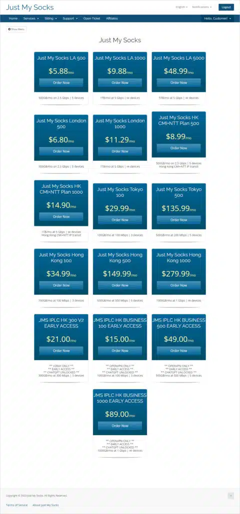
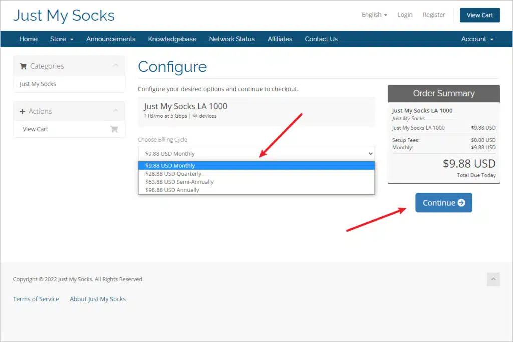
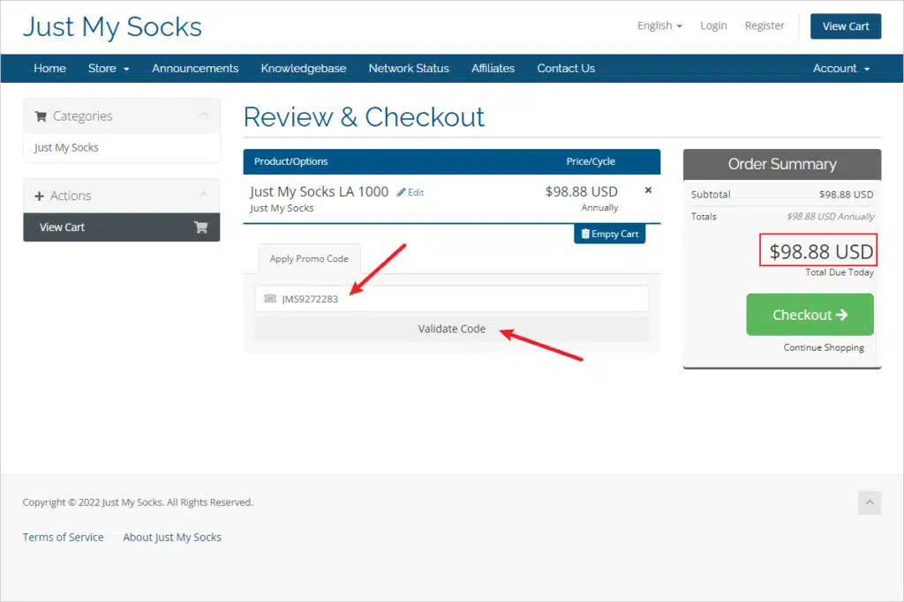
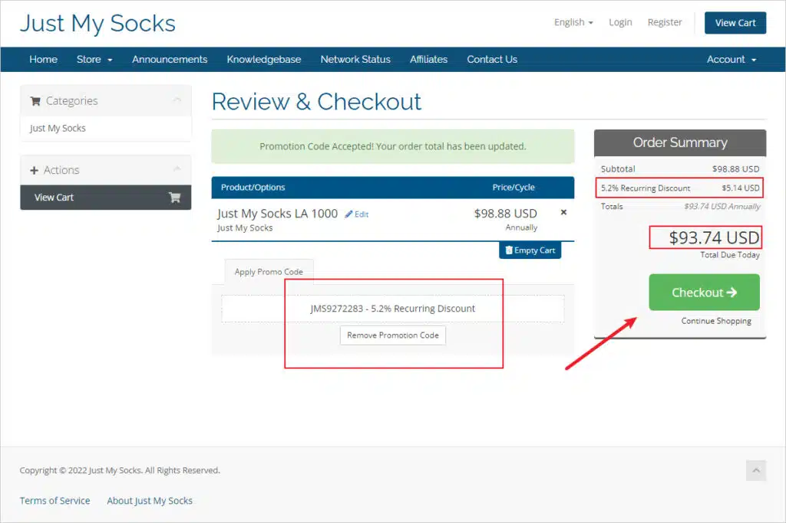
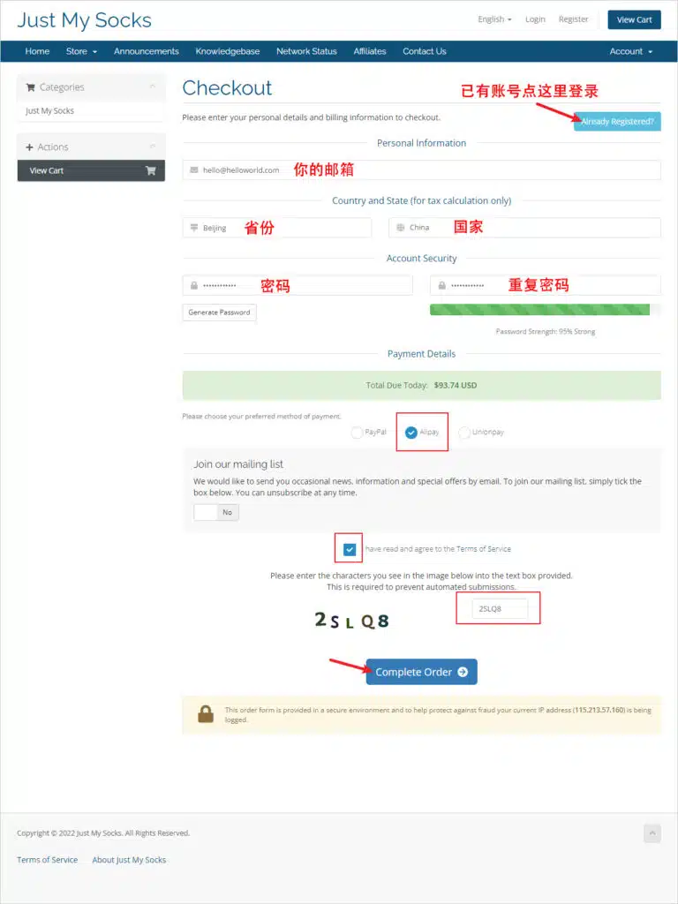
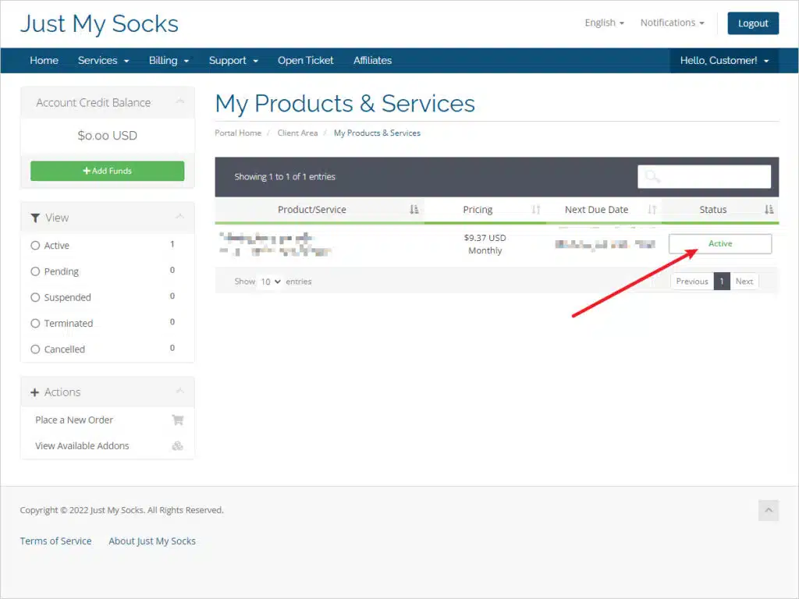
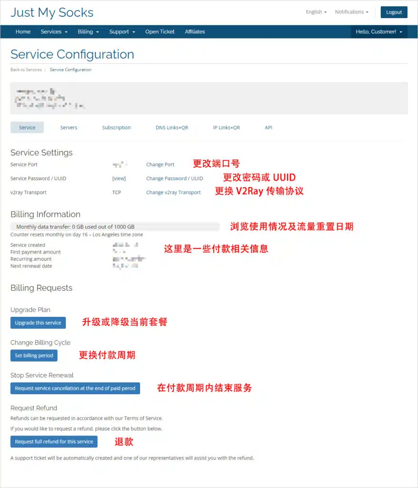
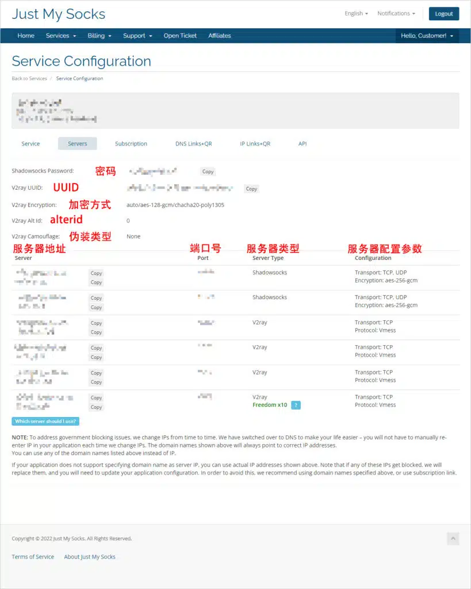
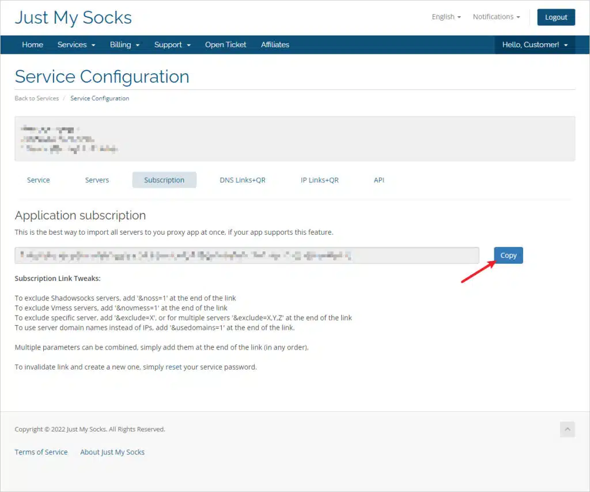
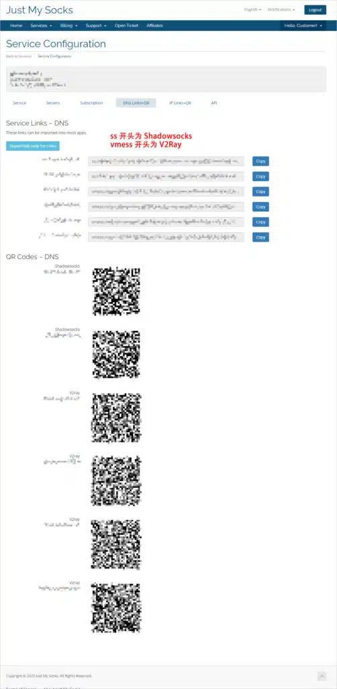

🇨🇳 [中文](README.md) | 🇺🇸 [English](README_EN.md) | 🇷🇺 Русский | 🇮🇷 [فارسی](README_FA.md)

# Just My Socks VPN от BandwagonHost: инструкция по регистрации и покупке со скидкой в 2026 году

Just My Socks — официальный VPN-сервис компании BandwagonHost, известного провайдера VPS-серверов с высокоскоростными сетевыми подключениями.

Сервис принимает оплату через Alipay, PayPal и банковские карты UnionPay. Если вы останетесь недовольны качеством обслуживания, в течение 7 дней после покупки можно запросить возврат средств. Такая политика возврата также свидетельствует об уверенности провайдера в качестве собственных продуктов.

Just My Socks использует высокоскоростные маршруты CN2 и CN2 GIA. Одной из важных особенностей сервиса является автоматическое переключение IP-адресов при блокировке текущего адреса, что помогает поддерживать скорость и стабильность соединения.

Just My Socks уже давно пользуется популярностью среди пользователей, которым необходим надёжный международный доступ к интернету.

Если вы планируете приобрести подписку, в этой статье подробно объясняются регистрация аккаунта, выбор тарифа и покупка с применением скидки.

[Инструкция по покупке Just My Socks VPN от BandwagonHost со скидкой](https://github.com/jdnei/Just-My-Socks)

---

## Официальный сайт

Официальный сайт VPN-сервиса Just My Socks от BandwagonHost:

[https://justmysocks.net/](https://to.iix.im/jms) (Недоступен из материкового Китая)

### Альтернативные официальные сайты

По различным причинам основной сайт иногда может оказаться недоступным.

Для решения этой проблемы провайдер создал несколько официальных зеркал, через которые пользователи могут открыть сайт Just My Socks, зарегистрироваться и приобрести подписку.

Все официальные зеркала используют общую базу аккаунтов и данных сервисов.

Если основной сайт не открывается, попробуйте следующие адреса:

* Официальное зеркало 1: [https://justmysocks1.net/](https://to.iix.im/jms) (Недоступно из материкового Китая)
* Официальное зеркало 2: [https://justmysocks2.net/](https://to.iix.im/jms) (Доступно из материкового Китая)
* Официальное зеркало 3: [https://justmysocks3.net/](https://to.iix.im/jms) (Доступно из материкового Китая)
* Официальное зеркало 4: [https://justmysocks5.net/](https://to.iix.im/jms) (Доступно из материкового Китая)

### Предварительный просмотр официального сайта



### Преимущества

В отличие от многих других VPN-провайдеров, Just My Socks официально управляется компанией BandwagonHost, что позволяет пользователям рассчитывать на высокий уровень стабильности и безопасности данных.

Десять основных преимуществ сервиса:

1. Официальный продукт BandwagonHost — надёжность и безопасность.
2. Отличная долгосрочная доступность и стабильность соединения.
3. Возможность возврата средств в течение 7 дней без объяснения причин.
4. Поддержка оплаты через Alipay и UnionPay.
5. Высокоскоростные маршруты CN2 GIA.
6. Автоматическая смена IP-адреса при его блокировке.
7. Поддержка настройки через доменное имя без необходимости постоянно менять конфигурацию.
8. Поддержка протоколов TCP и UDP.
9. Возможность самостоятельно устанавливать пароль сервера.
10. Возможность самостоятельно изменять порт сервера.

Теперь, когда мы рассмотрели основные преимущества Just My Socks, перейдём к покупке подписки со скидкой.

---

## Выбор расположения сервера

В настоящее время Just My Socks предлагает пять вариантов расположения серверов: Лос-Анджелес в США, Лондон в Великобритании, Токио в Японии, Гонконг в Китае и одно нераскрытое местоположение.

В каждом регионе доступно несколько тарифных планов.

### Тарифы и цены

| Дата-центр | Тариф | Трафик в месяц | Цена за месяц | Лимит устройств | Ссылка для покупки |
| :--- | :--- | :--- | :--- | :--- | :--- |
| **Лос-Анджелес** | LA 500 | 500 GB | $5.88 | 5 | [Купить со скидкой](https://to.iix.im/jms02) |
| **Лос-Анджелес** | LA 1000 | 1 TB | $9.88 | Без ограничений | [Купить со скидкой](https://to.iix.im/jms03) |
| **Лос-Анджелес** | LA 5000 | 5 TB | $48.99 | Без ограничений | [Купить со скидкой](https://to.iix.im/jms04) |
| **Лос-Анджелес** | LA 10000 | 10 TB | $93.99 | Без ограничений | [Купить со скидкой](https://to.iix.im/jms23) |
| **Лондон** | London 500 | 500 GB | $6.80 | 5 | [Купить со скидкой](https://to.iix.im/jms12) |
| **Лондон** | London 1000 | 1 TB | $11.29 | Без ограничений | [Купить со скидкой](https://to.iix.im/jms14) |
| **Гонконг** | HK CMI+NTT Plan 500 | 500 GB | $8.99 | 5 | [Купить со скидкой](https://to.iix.im/jms13) |
| **Гонконг** | HK CMI+NTT Plan 1000 | 1 TB | $14.90 | Без ограничений | [Купить со скидкой](https://to.iix.im/jms15) |
| **Гонконг** | HK CMI+NTT Plan 5000 | 5 TB | $59.99 | Без ограничений | [Купить со скидкой](https://to.iix.im/jms24) |
| **Токио** | Tokyo 100 | 100 GB | $29.99 | 3 | [Купить со скидкой](https://to.iix.im/jms05) |
| **Токио** | Tokyo 500 | 500 GB | $135.99 | 5 | [Купить со скидкой](https://to.iix.im/jms06) |
| **Токио** | Tokyo 1000 | 1 TB | $239.00 | Без ограничений | [Купить со скидкой](https://to.iix.im/jms22) |
| **Токио** | Tokyo 5000 | 5 TB | $1135.00 | Без ограничений | [Купить со скидкой](https://to.iix.im/jms26) |
| **Гонконг** | Hong Kong 100 | 100 GB | $34.99 | 3 | [Купить со скидкой](https://to.iix.im/jms07) |
| **Гонконг** | Hong Kong 500 | 500 GB | $149.99 | 5 | [Купить со скидкой](https://to.iix.im/jms08) |
| **Гонконг** | Hong Kong 1000 | 1000 GB | $279.99 | Без ограничений | [Купить со скидкой](https://to.iix.im/jms11) |
| **Гонконг** | IPLC HK 300 V2 | 300 GB | $21.00 | 3 | Снят с продажи |
| **Гонконг** | IPLC HK 1000 V2 | 1 TB | $59.00 | Без ограничений | Снят с продажи |

### Информация о тарифах

#### Рекомендуемые тарифы

Если для вас важно оптимальное соотношение цены и возможностей, рекомендуется тариф **LA 500**. Он позволяет одновременно использовать до пяти устройств.

Если сервисом планируют пользоваться несколько человек, рассмотрите **LA 1000**, поскольку этот тариф не ограничивает количество устройств.

Пользователям материкового Китая, для которых скорость и минимальная задержка важнее стоимости, могут подойти серверы Гонконга и Токио благодаря их географической близости.

Для корпоративного использования рекомендуются тарифы **Hong Kong 500** и **Hong Kong 1000**, ориентированные на высокую скорость и стабильность.

#### Ежемесячный объём трафика

Краткое пояснение единиц измерения данных:

**1 GB = 1024 MB = 1024 × 1024 KB**

Для просмотра сериалов:

* **Стандартное качество:** Одна серия продолжительностью 45 минут занимает примерно 100 MB. Одного гигабайта хватит приблизительно на 10 серий.
* **Качество 540p:** Одна серия занимает около 200 MB. Одного гигабайта хватит приблизительно на 5 серий.
* **Качество 720p:** Одна серия занимает около 350 MB. Одного гигабайта хватит приблизительно на 3 серии.

Если вы преимущественно используете Google для поиска информации, WhatsApp для общения с клиентами и Facebook для привлечения новых клиентов, даже тарифы с небольшим объёмом трафика, такие как Tokyo 100, Hong Kong 100 или IPLC HK 100, предоставляющие примерно 100 GB в месяц, обычно будут достаточными.

#### Ограничения по количеству устройств

В списке тарифов:

* **∞ devices:** Количество устройств не ограничено.
* **5 devices:** Одновременно поддерживается до пяти устройств.

---

## Добавление тарифа в корзину

Выберите подходящий сервер и тарифный план из таблицы выше.

Нажмите соответствующую ссылку для покупки со скидкой, проверьте период оплаты и добавьте тариф в корзину.



### Выбор периода оплаты

В раскрывающемся меню `Choose Billing Cycle` выберите продолжительность подписки.

Например:

`$xx.xx USD Annually`

Эта надпись означает ежегодную оплату.

Рекомендуется выбирать годовую подписку, поскольку её общая стоимость примерно соответствует оплате 10 месяцев вместо 12, позволяя сэкономить около двух месяцев абонентской платы.

Дополнительную экономию можно получить, применив промокод.

После выбора периода оплаты нажмите `Continue`, чтобы добавить тариф в корзину.

### Сравнение периодов оплаты

| Вариант оплаты | Период оплаты | Скидка относительно ежемесячной оплаты | Общая скидка с промокодом |
| :--- | :--- | :--- | :--- |
| Monthly | Ежемесячно | Без скидки | 5.2% |
| Quarterly | Раз в 3 месяца | 2.6% | 7.8% |
| Semi-Annually | Раз в 6 месяцев | 9.1% | 14.3% |
| Annually | Ежегодно — наиболее выгодный вариант | 16.6% | 21.8% |

---

## Применение промокода при оформлении заказа

### Промокод / Код скидки

`Используйте этот промокод для получения постоянной скидки 5,2%.`

```bash
JMS9272283
```

На странице оформления заказа найдите поле `Apply Promo Code` и введите промокод Just My Socks:

`JMS9272283`

Этот код предоставляет постоянную скидку 5,2%.

После ввода нажмите `Validate Code`.



### Оформление заказа с применённой скидкой

На следующем скриншоте показан пример успешного применения промокода.

В данном примере размер скидки составляет **$5.14**, а итоговая стоимость после скидки — **$93.74**.



Если все данные правильные, нажмите `Checkout`, чтобы продолжить.

---

## Завершение регистрации и покупки

Если у вас ещё нет аккаунта, на странице оформления заказа потребуется зарегистрироваться.

Заполните необходимые поля, ориентируясь на скриншот ниже.

**Важно:** Указывайте правильный адрес электронной почты и убедитесь, что можете получать письма с активацией аккаунта. В противном случае после покупки могут возникнуть проблемы с активацией и использованием сервиса.



В приведённом примере в поле `Country` необходимо выбрать `China`.

В качестве способа оплаты можно выбрать `Alipay`.

Параметр `Join our mailing list` позволяет подписаться на официальную почтовую рассылку, включая уведомления об акциях и скидках.

По умолчанию установлено значение `NO`, то есть рекламные сообщения поступать не будут.

Затем установите флажок:

`I have read and agree to the Terms of Service`

Введите проверочный код и нажмите `Complete Order`.

После этого откроется страница оплаты Alipay, где можно отсканировать платёжный QR-код и завершить транзакцию.

После оплаты проверьте электронную почту и найдите письмо с темой:

`Confirm Your Registration`

Перейдите по ссылке в письме, чтобы активировать аккаунт.

На этом регистрация и покупка завершены.

---

## Просмотр информации о серверах

После успешной оплаты можно войти в панель управления аккаунтом и посмотреть настройки серверов.

### Список доступных серверов

Откройте сайт Just My Socks и перейдите в меню:

`Services` > `My Services`

Здесь отображается информация о приобретённых услугах.

Если в столбце `Status` указано `Active`, соответствующий сервис активен и доступен для использования.



### Информация о сервере

Нажмите на сервис со статусом `Active`, чтобы посмотреть подробные параметры подключения.



На этой странице отображаются все важные сведения о приобретённом сервисе.

#### Service Settings

В этом разделе можно:

* Изменить порт сервера.
* Изменить пароль сервера.
* Изменить UUID.
* Переключить протокол подключения.

#### Billing Information

Этот раздел показывает текущий расход трафика и платёжную информацию.

Например:

`Counter resets monthly on day 16 – Los Angeles time zone`

Это означает, что доступный объём трафика обновляется 16-го числа каждого месяца.

Дата обновления зависит от даты оплаты, а время определяется по часовому поясу Лос-Анджелеса.

#### Billing Requests

В этом разделе доступны различные действия по управлению подпиской.

| Параметр | Описание |
| :--- | :--- |
| Upgrade Plan | Повышение или понижение текущего тарифного плана |
| Change Billing Cycle | Изменение периода оплаты, например переход с ежемесячной оплаты на годовую |
| Stop Service Renewal | Автоматическое прекращение обслуживания после окончания оплаченного периода |
| Request Refund | Отправка запроса на возврат средств |

---

## Настройка VPN-серверов

Just My Socks поддерживает пять способов настройки серверов:

1. Ручная настройка.
2. Настройка через URL подписки.
3. Импорт через ссылку или QR-код.
4. Настройка через IP-адрес или QR-код.
5. Настройка через API.

В этом руководстве рассматриваются первые три способа.

**Рекомендуется использовать URL подписки.**

### Ручная настройка сервера

Если ручная настройка не является обязательной, лучше использовать ссылку подписки, конфигурационную ссылку или QR-код.

Эти способы быстрее, удобнее и снижают вероятность ошибок при вводе параметров.

В панели управления аккаунтом откройте раздел `Servers`, чтобы посмотреть настройки серверов.



#### Настройка сервера Shadowsocks

Найдите строку, в которой значение `Server Type` равно `Shadowsocks`.

В соответствующей строке отображаются параметры подключения Shadowsocks.

Поле `Encryption` указывает метод шифрования. При настройке клиента Shadowsocks обязательно выберите правильный метод.

Пароль указан в поле `Shadowsocks Password`.

Для настройки Shadowsocks обычно достаточно четырёх параметров:

1. Адрес сервера.
2. Метод шифрования.
3. Порт сервера.
4. Пароль.

После ввода этих данных в совместимый клиент можно установить соединение.

#### Настройка сервера V2Ray

Найдите строку, в которой значение `Server Type` равно `V2Ray`.

В соответствующей строке содержатся параметры подключения V2Ray.

Поле `Protocol` указывает транспортный протокол, который необходимо правильно выбрать в клиенте V2Ray.

Другие необходимые параметры находятся в полях, названия которых начинаются с `V2Ray`:

* **Идентификатор пользователя:** `V2Ray uuid`
* **Дополнительный идентификатор:** `V2Ray Alt Id` — в данном примере `0`.
* **Шифрование:** `auto`
* **Транспортный протокол:** `TCP`
* **Тип маскировки:** `V2Ray Camouflage` — в данном примере `none`.

#### Примечания по ручной настройке

* Shadowsocks и V2Ray используют одинаковый порт сервера.
* Настройки различных серверов обычно совпадают, за исключением адреса сервера.
* Рекомендуется использовать доменное имя вместо IP-адреса.

Как упоминалось ранее, Just My Socks может автоматически менять IP-адрес сервера при блокировке текущего IP.

Использование доменного имени избавляет от необходимости вручную изменять адрес сервера при каждой смене IP.

### Настройка через URL подписки

Just My Socks поддерживает автоматическую настройку серверов с помощью URL подписки.

Достаточно скопировать ссылку подписки в совместимый клиент, чтобы импортировать параметры подключения без ручного ввода.

В панели управления аккаунтом найдите раздел `Subscription`.

Под заголовком `Application subscription` будет отображаться URL вашей подписки.



Нажмите `Copy`, чтобы скопировать ссылку подписки Just My Socks.

Затем вставьте её в совместимый VPN- или прокси-клиент с поддержкой импорта подписок.

После добавления ссылки необходимо выполнить обновление подписки в клиенте, чтобы загрузить настройки серверов.

#### Расширенные настройки URL подписки

Можно добавить следующие параметры в конец URL подписки:

* **Импортировать только серверы V2Ray:** Добавьте `&noss=1` в конец ссылки.
* **Импортировать только серверы Shadowsocks:** Добавьте `&novmess=1` в конец ссылки.
* **Исключить определённые серверы:** Добавьте `&exclude=X` для одного сервера или `&exclude=X,Y,Z` для нескольких.
* **Использовать доменные имена вместо IP-адресов:** Добавьте `&usedomains=1` в конец ссылки.

Эти параметры можно комбинировать в произвольном порядке.

### Настройка через ссылки или QR-коды

После приобретения подписки Just My Socks автоматически создаёт конфигурационные ссылки и QR-коды для доступных серверов.

Если VPN-клиент поддерживает сканирование QR-кодов, можно импортировать настройки непосредственно с их помощью.

В панели управления найдите параметр `DNS Link` + `QR`.

Этот способ использует доменные имена в качестве адресов серверов и рекомендуется для использования.

Откройте соответствующий раздел, чтобы увидеть конфигурационные ссылки и QR-коды.



#### Ссылки подключения Just My Socks

Нажмите `Copy`, чтобы скопировать конфигурационную ссылку сервера.

Затем импортируйте ссылку в совместимое клиентское приложение.

Префикс ссылки определяет протокол:

* `ss://` — ссылка сервера Shadowsocks.
* `vmess://` — ссылка сервера V2Ray.

#### QR-коды серверов Just My Socks

Отсканируйте соответствующий QR-код с помощью совместимого клиента с функцией сканирования.

Настройки сервера будут импортированы автоматически.

#### Особое примечание

В инструкции также упоминается способ настройки, при котором в качестве адреса сервера используется IP-адрес.

Прямое использование IP-адреса не рекомендуется, поскольку настройка через доменное имя упрощает автоматическую смену IP.

---

## Поддерживаемые клиентские приложения

Just My Socks поддерживает протоколы Shadowsocks и V2Ray.

Поэтому можно использовать любое совместимое приложение, поддерживающее эти протоколы.

Рекомендуемые клиенты:

* **Windows:** v2rayN / Clash for Windows
* **macOS:** V2rayU / ClashX
* **iOS:** Shadowrocket / Quantumult / Quantumult X
* **Android:** v2rayNG / Clash for Android

---

## Анализ скорости и сетевых маршрутов

### Серверы Гонконга

Подписка для Гонконга предоставляет доступ к пяти серверам, использующим одинаковые маршруты подключения.

* **Входящие маршруты**
  * China Telecom: CN2 GIA.
  * China Unicom: Прямое соединение.
  * China Mobile: Прямое соединение.
* **Исходящие маршруты**
  * China Telecom: CN2 GIA.
  * China Unicom: Прямое соединение.
  * China Mobile: Прямое соединение.

### Серверы Токио

Подписка для Токио предоставляет доступ к пяти серверам, использующим одинаковые маршруты подключения.

* **Исходящие маршруты**
  * China Telecom: CN2 GIA.
  * China Unicom: CN2 GIA.
  * China Mobile: CN2 GIA.
* **Входящие маршруты**
  * China Telecom: CN2 GIA.
  * China Unicom: CN2 GIA.
  * China Mobile: NTT.

### Серверы Лондона

Подписка для Лондона предоставляет доступ к пяти серверам, использующим одинаковые маршруты подключения.

* **Исходящие маршруты**
  * China Telecom: Премиальный международный маршрут China Unicom.
  * China Unicom: Премиальный международный маршрут China Unicom.
  * China Mobile: Премиальный международный маршрут China Unicom.
* **Входящие маршруты**
  * China Telecom: Премиальный международный маршрут China Unicom.
  * China Unicom: Премиальный международный маршрут China Unicom.
  * China Mobile: Level3.

### Серверы Лос-Анджелеса

Подписка для Лос-Анджелеса предоставляет доступ к шести серверам, маршруты которых немного различаются.

* Сервер `cXs1` использует CN2 GT и прямые соединения с China Unicom и China Mobile.
* Сервер `cXs2` использует CN2 GT и прямые соединения с China Unicom и China Mobile.
* Сервер `cXs3` использует прямой маршрут CN2 GIA компании China Telecom.
* Сервер `cXs4` использует соединение через узел POP компании BandwagonHost в Осаке, Япония.
* Сервер `cXs5` использует узел POP компании BandwagonHost в Нидерландах в сочетании с CN2 GIA и прямыми обратными маршрутами к China Telecom, China Unicom и China Mobile.

В названиях серверов символ `X` зависит от приобретённого тарифного плана.

Суффиксы `s1`–`s5` обозначают соответствующие серверы.

В тарифах Лос-Анджелеса также имеется маршрут V2Ray с названием `s801`.

Этот маршрут может обеспечивать более высокую пропускную способность при передаче больших объёмов данных, однако стабильность и скорость не гарантируются.

Он лучше подходит для загрузки крупных файлов, когда постоянство скорости не является главным требованием.

---

## Часто задаваемые вопросы

### Какие способы оплаты поддерживаются?

В настоящее время Just My Socks принимает:

* PayPal.
* Alipay.
* Банковские карты China UnionPay.

### Можно ли вернуть деньги?

Да. Just My Socks предоставляет возможность возврата средств в течение 7 дней после покупки.

### Поддерживается ли UDP?

* Серверы V2Ray во всех регионах не поддерживают UDP.
* Серверы Shadowsocks поддерживают UDP во всех регионах, за исключением снятого с продажи тарифа LA 100.

### Поддерживает ли Just My Socks доступ к ChatGPT?

По информации провайдера, сервис в настоящее время поддерживает доступ к ChatGPT.
